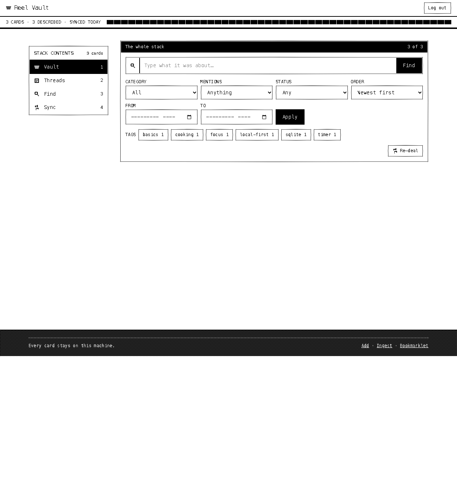

# Reel Vault

A local-first personal vault for the Instagram reels, posts, DM-shared links and
articles you save. Everything lives in a single SQLite file on your machine.

Saved reels can be transcribed, OCR'd, summarised and tagged so you can search
by what was actually said in them, not just by the caption. That happens in two
batch steps you run yourself (extract, then enrich), not automatically the
moment you save something. By default both steps run on local models, so no
paid API key is needed.

> Status: a personal project, built and tested on macOS (Apple Silicon). Rough
> edges are expected; see [Feedback](#feedback--report-a-bug).



## Features

- **One SQLite file** (`data/reel-vault.db`) via Node's built-in `node:sqlite`. No external database.
- **Three ways in:** an optional Instagram sidecar (saved collections + DMs), an
  Instagram data-export ZIP (`/ingest` or `POST /api/ingest`), paste/`share_target`
  capture on `/add`, a desktop `/bookmarklet`, and a token-protected share
  endpoint (`POST /api/share`) for an iOS Shortcut.
- **Transcripts and on-screen text:** `pipeline/extract.py` fetches caption and
  video, then transcribes speech with Whisper and reads burned-in text with OCR,
  all locally.
- **AI enrichment:** a local LLM (or optional free Groq models) writes a
  summary, category, tags, named entities and action items for each item.
- **Search:** the vault search matches titles, captions, summaries,
  transcripts and OCR text. `/chat` answers questions over the vault, citing items.
- **MCP server:** read-only, zero-dependency, so any MCP client (Claude Code,
  Claude Desktop, etc.) can query your vault.
- **Optional passcode gate** for the whole API.

## What needs what

| Step | Runs on | Needs |
|------|---------|-------|
| Web app, search, MCP server | Node 24+ | nothing else |
| Instagram sidecar (optional) | Python 3 | your Instagram login (see the warning below) |
| Fetch caption + video for a reel | Apify Free actor (default) or the sidecar | `APIFY_TOKEN` (free Apify account), or the sidecar running |
| Transcription | mlx-whisper (Apple Silicon) / faster-whisper (elsewhere), local | `./pipeline/setup.sh`, no key |
| OCR | Apple Vision + Tesseract (macOS) / RapidOCR (elsewhere), local | `./pipeline/setup.sh`, no key |
| Summary, category, tags | local OpenAI-compatible server (default `mlx_lm.server` with Qwen3-4B) | no key; or `LLM_PROVIDER=groq` + `GROQ_API_KEY` |

Without any of the optional pieces you still get the app, manual imports, search
over titles/captions, and the MCP server. Items simply stay unenriched.

## Requirements

- **Node 24+**: the data layer uses the built-in `node:sqlite` module.
- **Python 3.11 or 3.12**: only for the extraction pipeline or the Instagram sidecar.
- **Homebrew** (macOS): `pipeline/setup.sh` uses it to install `ffmpeg` and `tesseract`.

## Getting started

```bash
npm install
npm run dev        # http://localhost:3210 (Vite SPA + Hono API in one process)
```

On macOS you can also double-click `start-reel-vault.command`.

Create `.env.local` in the repo root for any of the settings under
[Configuration](#configuration-envlocal). It is git-ignored.

## Getting content into the vault

1. **Instagram sidecar** (optional): start it (below), then log in and sync from `/connect`.
2. **Paste / share / bookmarklet:** open `/add` (also the Android PWA `share_target`),
   or install the helper from `/bookmarklet`.
3. **Instagram data export:** request "Your activity" as JSON from Instagram, then
   use `/ingest` in the UI, or
   `curl --data-binary @instagram-export.zip http://localhost:3210/api/ingest`
   (the ZIP is the raw request body; add the `rv_auth` cookie if `APP_PASSCODE` is set).
4. **Share capture (iOS):** set `SHARE_TOKEN` and point an iOS Shortcut at
   `POST /api/share`. Setup: [`docs/share-capture.md`](docs/share-capture.md).

## Transcribe and enrich (the "search by what was said" part)

Full walkthrough: [`docs/KNOWLEDGE-BASE.md`](docs/KNOWLEDGE-BASE.md).

```bash
# 1. one-time install: ffmpeg, tesseract, Python venv, whisper + mlx packages
./pipeline/setup.sh

# 2. extract caption, transcript and OCR text (dry run first, then --run)
pipeline/.venv/bin/python pipeline/extract.py --stats
pipeline/.venv/bin/python pipeline/extract.py --limit 10 --run
#    default fetcher is Apify: needs APIFY_TOKEN in .env.local
#    to use the sidecar instead: --fetcher sidecar

# 3. start the local LLM (first run downloads about 2.3 GB)
pipeline/start-llm.command          # mlx_lm.server on 127.0.0.1:8090

# 4. with the app running, enrich everything pending
scripts/enrich-all.sh
```

You can also enrich from the "Enrich with AI" button on `/connect`. Transcripts
shorter than 15 characters (music-only reels) are discarded on purpose.

## Optional: Instagram sidecar

A local FastAPI service (`ig-bridge/`) that reads your saved collections and DMs
through Instagram's private mobile API (`instagrapi`).

```bash
cd ig-bridge
./start-bridge.command   # creates a venv, then runs on http://127.0.0.1:8765
```

> **Read this before using the sidecar.**
>
> - It uses Instagram's **private, undocumented** API. That is against
>   Instagram's Terms of Use.
> - Instagram can checkpoint, lock or permanently ban the account you log in
>   with. Built-in throttles (one gather per 20 hours, a 6 hour cooldown after
>   any rate limit, 25 s between media fetches) reduce the risk; they do not
>   remove it.
> - Use it **only with your own account**, for personal use, at your own risk.
>   Never use it on someone else's account or to collect other people's data.
> - The saved session (`ig-bridge/ig_session.json`) is a full login credential.
>   It is git-ignored and stays on `127.0.0.1`; never share or commit it.
>
> The safer paths are the official data export and share capture. The Apify
> fetcher is a third-party scraper of public pages; check that its use fits
> your situation too.

## MCP server

`mcp/reel-vault-mcp.mjs` exposes the vault over stdio. It is read-only and has
no npm dependencies.

```bash
claude mcp add reel-vault -- node "$(pwd)/mcp/reel-vault-mcp.mjs"
```

For other MCP clients, run `node /abs/path/to/mcp/reel-vault-mcp.mjs` as a stdio
server. It reads `data/reel-vault.db` next to the repo, or `REEL_VAULT_DB`.

Tools: `search_vault`, `get_item`, `list_entities`, `find_actions`,
`list_categories`, `recent_items`, `vault_stats`.

## Configuration (`.env.local`)

| Var | Effect |
|-----|--------|
| `APP_PASSCODE` | Enables a shared-passcode gate on `/api/*` (unset = open) |
| `AUTH_TTL_SECONDS` | Auth cookie lifetime (default 7 days); each login mints a fresh `v2` cookie |
| `TRUST_PROXY` | Set to `1` only behind a trusted reverse proxy (honours `X-Forwarded-*`) |
| `SHARE_TOKEN` | Enables the `/api/share` capture endpoint (unset = 503) |
| `APIFY_TOKEN` | Enables the default Apify fetcher in `pipeline/extract.py --run` |
| `LLM_PROVIDER` | `local` (default) or `groq` |
| `LLM_BASE_URL` | OpenAI-compatible base URL (default `http://127.0.0.1:8090/v1`, or Groq) |
| `LLM_MODEL` | Must be on the allow-list in `src/lib/llm.ts` |
| `GROQ_API_KEY` | Required only when `LLM_PROVIDER=groq` |
| `REEL_VAULT_WHISPER_MODEL` | Whisper weights (default `mlx-community/whisper-small-mlx`) |
| `KEEP_MEDIA` | Keep downloaded videos under `data/media/` |
| `REEL_VAULT_DB` | SQLite file path (default `data/reel-vault.db`) |
| `REEL_VAULT_MEDIA` | Media directory override |
| `IG_BRIDGE_URL` | Sidecar base URL (default `http://127.0.0.1:8765`) |
| `PORT` | Production server port (default `3210`) |
| `HOST` | Bind address (default `127.0.0.1`). Non-loopback binds require `APP_PASSCODE`. |
| `ALLOWED_HOSTS` | Extra Host header names accepted (comma-separated), for LAN access |

Sidecar-only (Python side): `IG_SESSION_FILE`, `IG_MIN_GATHER_INTERVAL_HOURS`,
`IG_COOLDOWN_HOURS`, `IG_MEDIA_MIN_INTERVAL_SECONDS`, `IG_PROXY` (optional
server-side proxy), `IG_ALLOW_CLIENT_PROXY` (must be `1`/`true` to honour a
client-supplied `proxy` on `/login`; off by default).

> **Network exposure:** the app and Vite dev server bind to `127.0.0.1` by
> default. To listen on the LAN, set `HOST` (for example `0.0.0.0`) and
> `APP_PASSCODE`; without a passcode a non-loopback bind is refused.

## Scripts

```bash
npm run dev      # dev server on :3210
npm run build    # dist/ (SPA) + dist-server/ (API)
npm start        # production server on :3210, loads .env.local
npm test         # vitest run
npx tsc --noEmit # typecheck (no npm script for it)
```

Pipeline tests: `pipeline/.venv/bin/python -m pytest pipeline/tests`.

## Feedback / report a bug

Bugs, missing features and rough edges are all welcome. Please open an issue:
[github.com/abhinay-hat/reel-vault/issues](https://github.com/abhinay-hat/reel-vault/issues).
There are templates for bug reports and feature requests.

Please do not paste Instagram session files, cookies, tokens or your database
into an issue.

## License

MIT. See [LICENSE](LICENSE). Copyright (c) 2026 Abhinay Reddy Padidam.

Third-party notices: [THIRD_PARTY_NOTICES.md](THIRD_PARTY_NOTICES.md).
