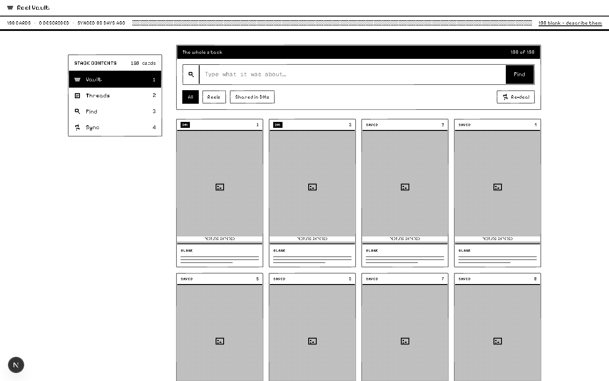
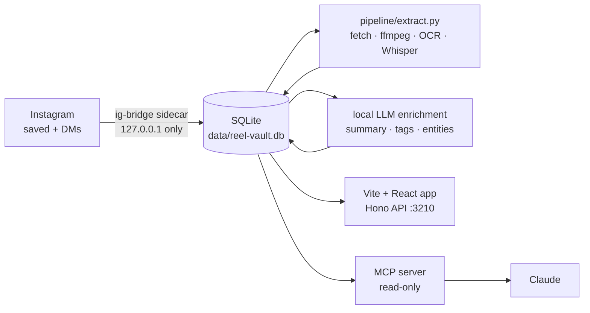

<div align="center">

# ▤ Reel Vault

**Everything you saved on Instagram, finally findable.**

A local-first vault for your saved reels, posts and the links friends send you in DMs —
searchable by what the video actually *says*, not just its caption.

One SQLite file. Your machine. No cloud account.


-000?style=flat-square)




</div>

---

## Why

You save a reel about a scholarship deadline, an editing trick, a recipe. Three months later
you can't find it: Instagram search doesn't look inside saved posts, and DM-shared reels arrive
as bare links with no caption at all.

Reel Vault pulls them into one place, **transcribes and reads them**, and lets you ask
*"that reel about the Japanese visa"* — in the app, or straight from Claude.

## What it does

| | |
|---|---|
| **Collect** | Saved reels and posts, plus every reel shared inside your DM threads |
| **Extract** | Caption, keyframes, on-screen text (OCR, incl. Hindi and Telugu) and the spoken transcript (Whisper) |
| **Understand** | A local LLM writes a summary, category, tags, named entities (films, tools, universities, job portals…) and action items |
| **Find** | Full-text search across title, caption, transcript, on-screen text and entities |
| **Ask** | `/chat`: questions answered from your own reels, with the source cards |
| **Reuse** | An MCP server so Claude can search your vault from any conversation |

## How it works



Every step is idempotent and resumable: items move `pending → fetched → transcribed → enriched`,
so a crash or a closed laptop just means the next run picks up where it stopped.

## Quick start

Requires **Node 24+** (the data layer uses the built-in `node:sqlite`).

```bash
npm install
npm run dev        # app + API on http://localhost:3210
```

On macOS you can double-click `start-reel-vault.command` instead.

### 1 · Connect Instagram (optional sidecar)

```bash
cd ig-bridge && ./start-bridge.command    # FastAPI on http://127.0.0.1:8765
```

Then log in and sync from **/connect**.

> [!WARNING]
> The sidecar uses Instagram's **private** mobile API (`instagrapi`). That breaks Instagram's
> Terms of Service and can get an account checkpointed or banned. Use it only with your own
> account, at your own risk. The session never leaves `127.0.0.1`, and sync is throttled hard
> on purpose.

### 2 · Extract the content

```bash
./pipeline/setup.sh                 # one-time: Python deps, ffmpeg, Tesseract
python pipeline/extract.py --run    # captions, keyframes, OCR, transcripts
```

Heavy runs work well on a GPU box (`pipeline/run-windows.bat` uses faster-whisper on CUDA). Stages, fetchers and statuses are explained in [docs/KNOWLEDGE-BASE.md](docs/KNOWLEDGE-BASE.md).

### 3 · Enrich with a local LLM

```bash
./pipeline/start-llm.command        # OpenAI-compatible mlx_lm.server (Qwen3-4B)
./scripts/enrich-all.sh             # summaries, tags, entities, actions
```

Set `LLM_PROVIDER=groq` to use Groq's free models instead.

## Ask Claude about your saves (MCP)

```bash
claude mcp add reel-vault -- node /absolute/path/to/mcp/reel-vault-mcp.mjs
```

Zero dependencies, **read-only by design**. Tools:

`search_vault` · `get_item` · `list_entities` · `find_actions` · `list_categories` · `recent_items` · `vault_stats`

> *"Which job portals have I saved?"* · *"List every anime from my saves."* · *"What did that reel say about the visa deadline?"*

## Configuration

Put these in `.env.local` (all optional):

| Variable | Effect |
|---|---|
| `APP_PASSCODE` | Turns on a shared-passcode gate (unset = open app) |
| `SHARE_TOKEN` | Enables `/api/share` for the iOS Shortcut / share target |
| `APIFY_TOKEN` | Apify free fetcher for `extract.py --run` |
| `LLM_PROVIDER` / `LLM_BASE_URL` / `LLM_MODEL` | `local` (default) or `groq`; model must be on the allow-list |
| `GROQ_API_KEY` | Only when `LLM_PROVIDER=groq` |
| `REEL_VAULT_DB` / `REEL_VAULT_MEDIA` | Database and media paths |
| `REEL_VAULT_WHISPER_MODEL` | Whisper weights (default `mlx-community/whisper-small-mlx`) |
| `KEEP_MEDIA` | Keep downloaded mp4s under `data/media/` |
| `IG_BRIDGE_URL` | Sidecar URL (default `http://127.0.0.1:8765`) |

## Scripts

```bash
npm run dev      # Vite dev server + API on :3210
npm run build    # dist/ (SPA) + dist-server/index.js (Hono API + static)
npm start        # production server on :3210
npm test         # vitest
```

## Under the hood

```
src/            React 19 pages (src/app/**/page.tsx), components, lib (db, ai, llm, search)
server/         Hono app; auto-mounts every src/app/api/**/route.ts
ig-bridge/      Python FastAPI sidecar for Instagram (local only)
pipeline/       extraction: fetch → ffmpeg keyframes → OCR → Whisper
mcp/            zero-dependency MCP server over the same SQLite file
```

- **Stack:** Vite 8 · React 19 · react-router 8 · Tailwind v4 · Hono · `node:sqlite`
- **Data:** one SQLite file; items upsert by URL, DM messages insert-or-ignore, so every import is safe to repeat
- **Design:** a 1-bit HyperCard shoebox stack: black ink, white paper, dithered greys, and a vault that shows what's still blank instead of pretending it's complete

## Privacy

Your vault stays on your machine. No telemetry, no hosted backend. The only network calls are
the ones you turn on: the local Instagram sidecar, the optional Apify fetcher, and Groq if you
choose it over the local LLM.

## Credits

Parts of the offline media / OCR pipeline are ported from
[reel-watcher](https://github.com/jakeb144/reel-watcher) (MIT). See
[THIRD_PARTY_NOTICES.md](THIRD_PARTY_NOTICES.md).

<div align="center"><sub>Built for one person who saves far more than they ever rewatch.</sub></div>
